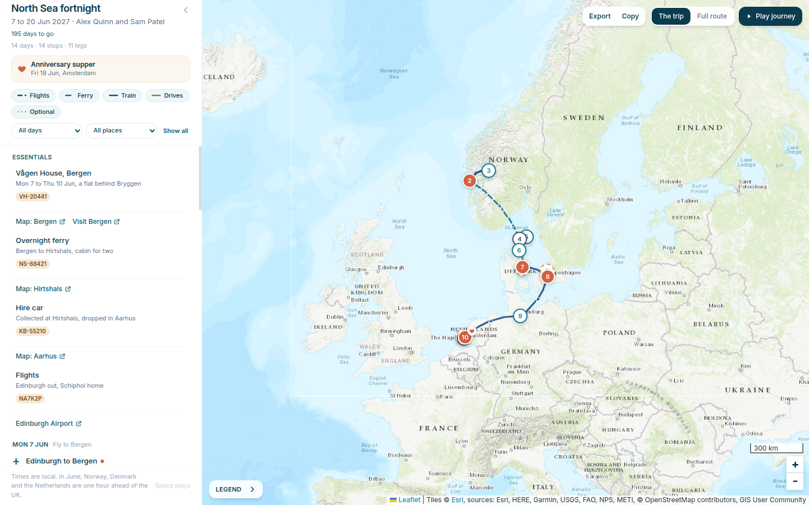
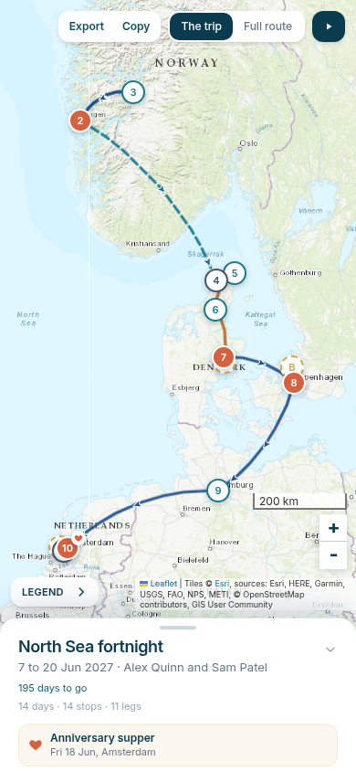
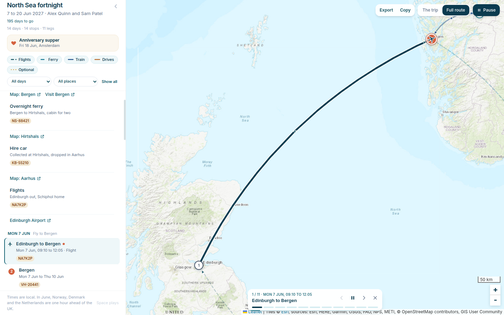
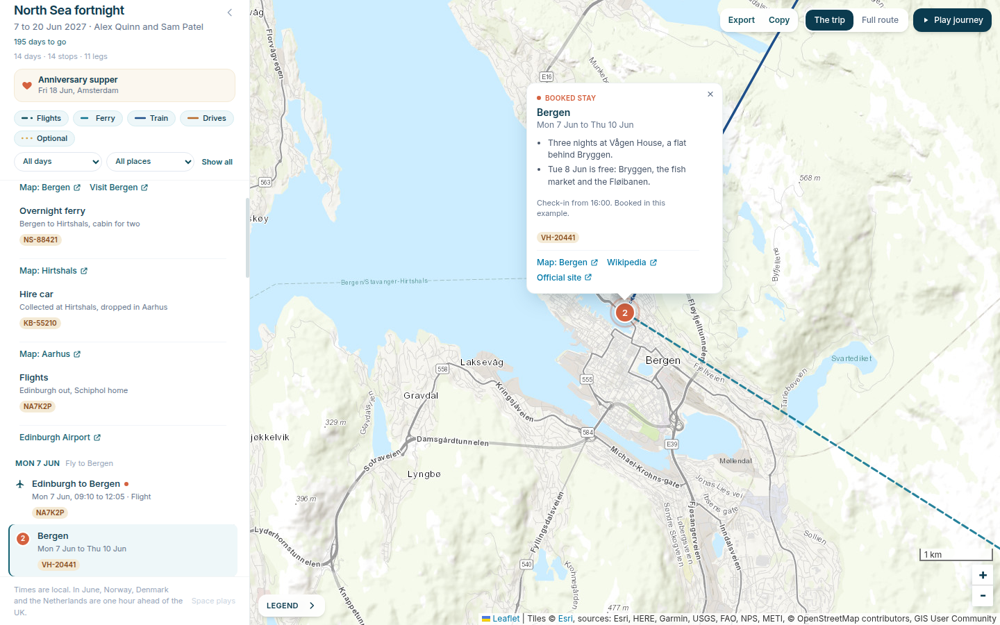
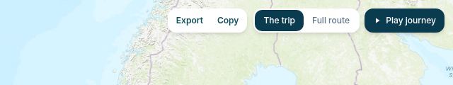
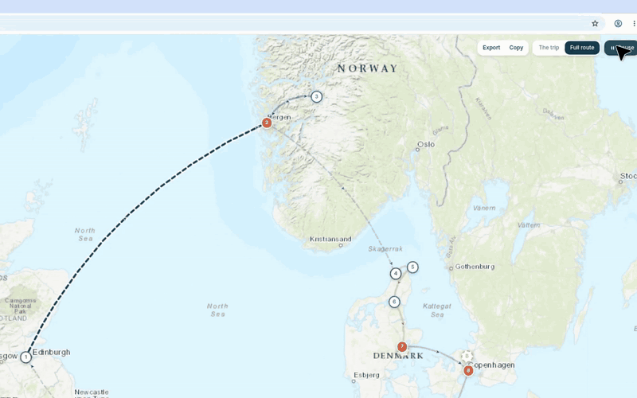

# journey-map-skill

An agent skill that turns a free-text trip description into a day-by-day itinerary and a single interactive HTML journey map.

You paste a rough plan. The skill asks one short batch of questions about anything that is still ambiguous, drafts an itinerary for you to confirm, then fills a template. The result is one HTML file you can open in a browser. No build, no account, no server.

Open the example in a browser, with no login: [North Sea fortnight](https://htmlpreview.github.io/?https://github.com/rsordillo/journey-map-skill/blob/main/examples/north-sea-fortnight.html). After this repo has a GitHub Pages site, that is the other no-login option (enable Pages on `main`, then the same file is served from the Pages host).

The route lines are curved to match the Mercator tiles, with an arrowhead for direction. Colour and dash follow the mode: flight, ferry, train, drives, or an optional idea. A day trip out and back uses a faint return arc so several spokes from one base stay readable. Click a place for notes, booking chips, and links. Filters narrow the map by transport, day, or kind of place. The trip view hides the home airport. Full route brings it back. Play journey steps through the legs, then returns to the view you had before. The legend starts collapsed.

A place popup, with links out:

Export and Copy sit in the top bar. Export downloads a CSV that Excel and Google Sheets can open. Copy puts the same table on the clipboard.

## Try the example

The fictional two-week trip runs from Edinburgh to Bergen, on by train to Flåm, by overnight ferry to Denmark, down the coast by car, then by train to Copenhagen and, via Hamburg, to Amsterdam.

The people, dates, and booking references are invented. Nothing in the example is a real reservation.

- The map file: [`examples/north-sea-fortnight.html`](examples/north-sea-fortnight.html)
- The note that started it: [`examples/example-prompt.md`](examples/example-prompt.md)
- The itinerary after one round of questions: [`examples/example-itinerary.md`](examples/example-itinerary.md)
- The spreadsheet the Export button writes: [`examples/north-sea-fortnight-timeline.csv`](examples/north-sea-fortnight-timeline.csv)

On the map, Space starts and pauses the tour. The arrow keys step through legs. Escape closes it and restores the view from before Play.

## Use the skill

The instructions live in [`SKILL.md`](SKILL.md). The blank map lives in [`template/journey-map.html`](template/journey-map.html). Keep those two together: the skill tells the agent to copy the template and replace only the `TRIP` object near the top of the file.

**Claude, and other Anthropic-style skills.** Put this folder where you keep skills, so `SKILL.md` sits next to `template/`. Claude Code reads a skill from `.claude/skills/journey-map/` (or your user skills directory) when the description matches.

**Cursor.** Add the folder as a project skill, or point a rule at `SKILL.md`, and leave `template/journey-map.html` in the project so the agent can read it.

**ChatGPT, or any other chat model.** Paste the body of `SKILL.md` into the custom instructions (or attach it), and attach `template/journey-map.html` in the conversation when you ask for the map. The model only has to fill the data block.

In every case the agent should ask about real gaps, show you a Markdown itinerary, and wait for a yes before it writes the HTML.

## Tiles

CARTO Voyager, the quieter basemap these maps were designed around, now needs a free API key. Two ways to set one, with no other code change:

- Set `cartoApiKey` inside the `TRIP` object, or
- Open the file once with `?cartoKey=YOUR_KEY` on the URL. The page stores it in that browser.

Voyager is used only when a key is set, and the legend note stays hidden. With no key the map uses Esri World Topo, then Esri World Street if those tiles fail. OpenStreetMap is a last resort, and only when the page is served over http or https. A file opened from disk sends no Referer, and the OSM tile servers answer 403, so that basemap is not requested there. A keyless CARTO URL is not requested either: it answers 200 with an "API KEY REQUIRED" placeholder instead of a map.

The legend names whichever basemap is actually showing, and says how to add a CARTO key. The corner credit matches the provider.

The key request page is [carto.com/basemaps](https://carto.com/basemaps).

Fonts, Tailwind, and Leaflet are loaded from CDNs, so the file needs a network connection the first time you open it. The trip itself is all in the file. Export and Copy need no extra library, and Export works from a file you opened off disk.

## Spreadsheet

Export builds `<trip-slug>-timeline.csv` in the browser. The file is UTF-8 with a byte order mark, so Excel keeps accents. Each row is one part of the plan, in order: a leg, a stop, or a quiet day. Link columns are `=HYPERLINK` formulas (a map link, then further links, each with its own label). `All links` repeats the raw URLs. Text that starts with `=`, `+`, `-`, or `@` is prefixed with an apostrophe so a note cannot turn into a formula. Copy does the same table as tab-separated text, for a paste into Google Sheets.

## Layout

| Path | What it is |
| --- | --- |
| `SKILL.md` | The instructions an agent follows |
| `template/journey-map.html` | The map, with a placeholder trip in `TRIP` |
| `examples/` | A fictional prompt, the itinerary, the map, and its timeline CSV |
| `docs/` | Screenshots and a short demo of the example |

## Contributing

Issues and pull requests are welcome. Bug fixes, another transport mode, and clearer copy are all in scope.

Please keep a few habits:

- Trip facts belong in the `TRIP` object. The rest of the HTML is the engine, shared by every map.
- `examples/north-sea-fortnight.html` is the template with a filled `TRIP`. If you change the engine, change it in both files.
- Do not commit real booking references, private addresses, emails, or phone numbers. The `uploads/` folder is gitignored for that reason.
- The example travellers are fictional. Leave them fictional.

## Licence

[MIT](LICENSE).
